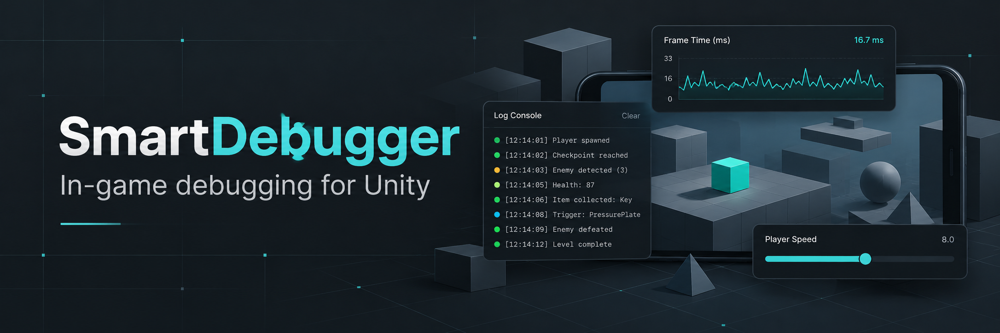
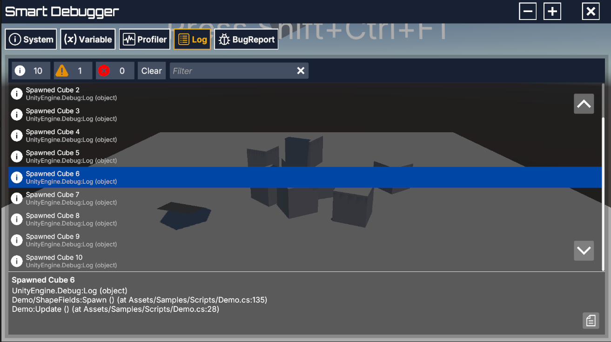
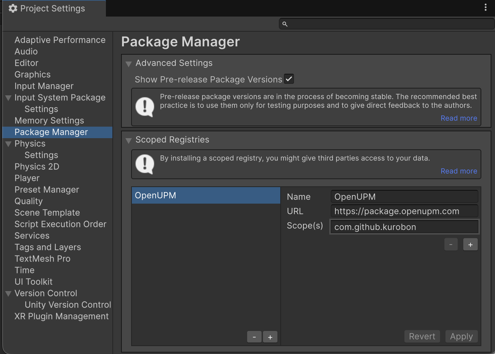
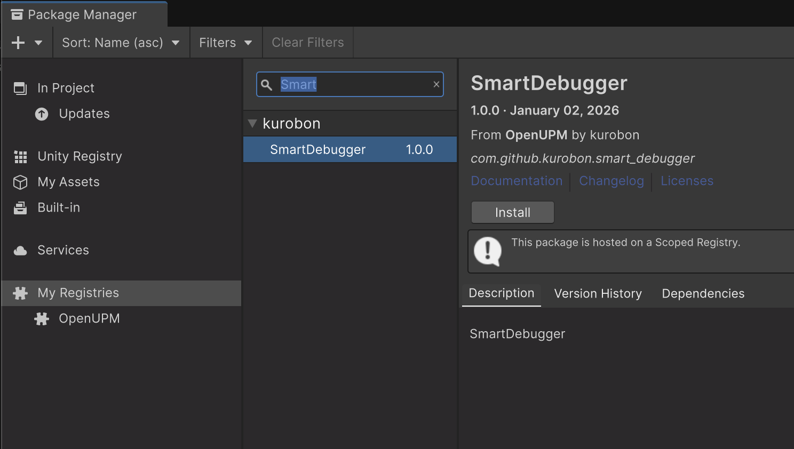
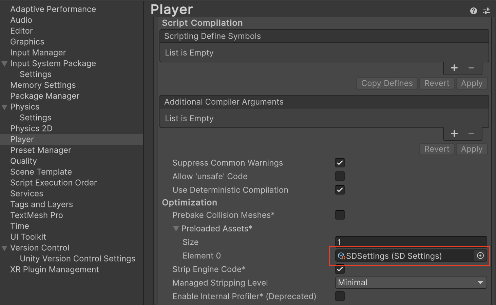
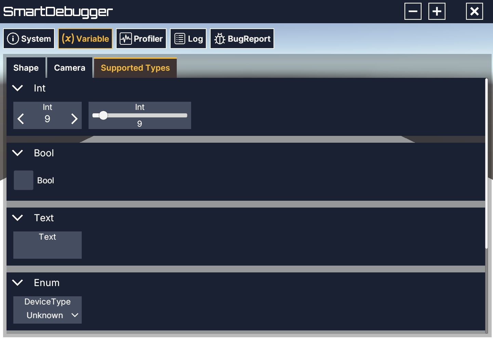
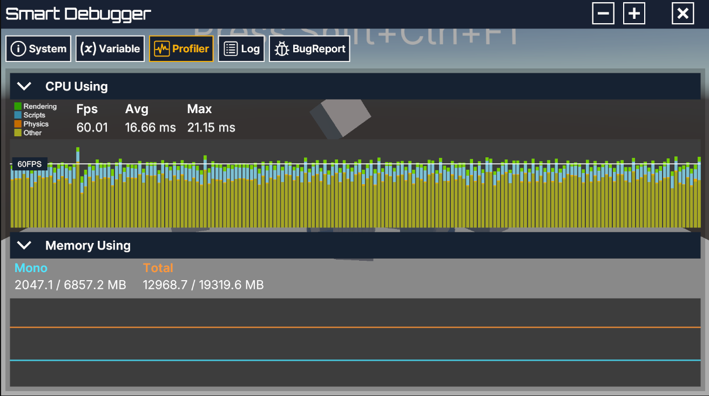
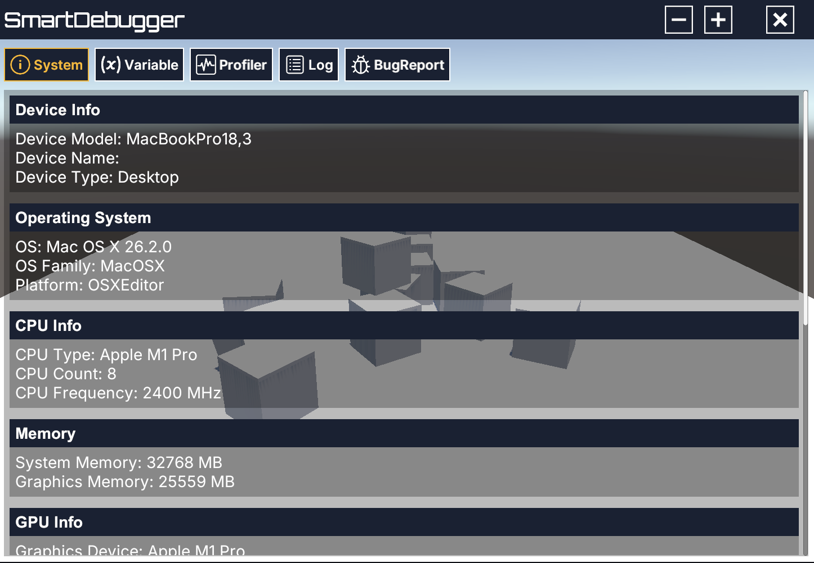
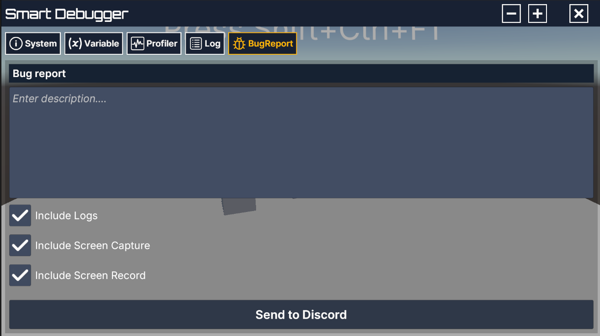
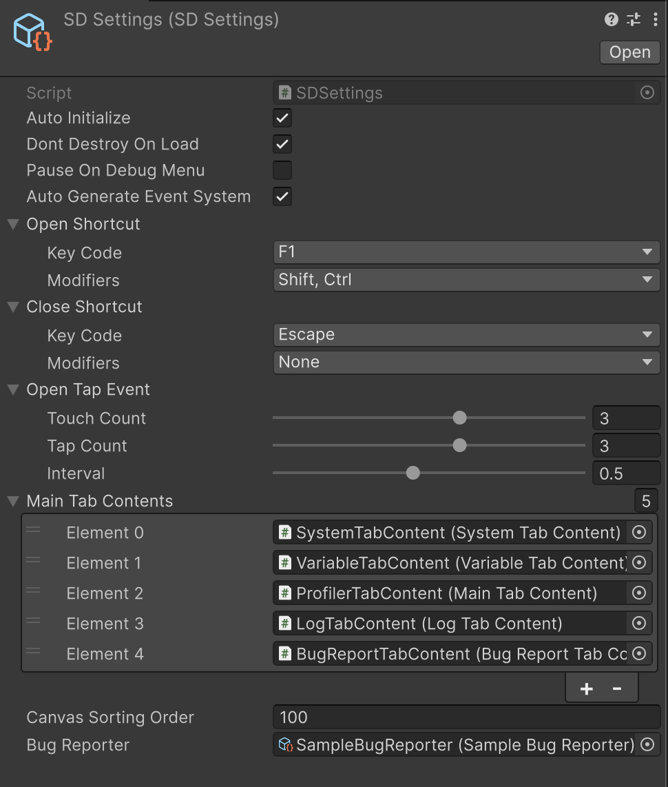

[English](README.md) · 日本語

**問題が起きたその場で、ゲームの状態を確認。**

実行中の変数、ログ、パフォーマンスグラフ、不具合報告をUnityビルドの中で。

[OpenUPM](https://openupm.com/packages/com.github.kurobon.smart_debugger/) ·
[クイックスタート](#クイックスタート) ·
[API使用例](#実行中の変数を操作する) ·
[変更履歴](CHANGELOG.md) ·
[MITライセンス](LICENSE)

SmartDebuggerは、Unityゲームに拡張可能なデバッグメニューを追加するパッケージです。Android・iOSを中心に、スタンドアロンビルドでも利用できます。Editorに接続せずに、実機で端末情報の確認、パラメーターの変更、Unityログの閲覧、不具合報告を行えます。

## 主な機能

| ツール | できること |
| --- | --- |
| **System** | ビルド識別情報、OS、端末、CPU、GPU・ドライバー、メモリ、画面・Safe Area、描画・FPS設定、システム言語、起動後の経過時間、時間倍率を確認。 |
| **Variables** | 型付きの値、スライダー、選択肢、ラベル、アクションをC# APIで追加。 |
| **Logs** | 種別・文字列で絞り込み、スタックトレースの確認、コピー、新着ログの追従。 |
| **Profiler** | FPS、フレーム時間、マネージドメモリや総メモリの割り当て・予約量を確認。 |
| **Bug reports** | 説明、システム情報、ログ、スクリーンショット、任意の録画を送信。 |



## インストール

コアパッケージの対応バージョンは **Unity 2022.1以降**です。画面録画には **Unity 2022.3以降**と、任意導入のInstantReplay連携が必要です。

### OpenUPM

1. **Edit → Project Settings → Package Manager**を開きます。
2. 次のScoped Registryを追加します。

   | 項目 | 値 |
   | --- | --- |
   | Name | `OpenUPM` |
   | URL | `https://package.openupm.com` |
   | Scope | `com.github.kurobon` |

3. **Window → Package Manager**を開き、**My Registries**から **SmartDebugger**（`com.github.kurobon.smart_debugger`）をインストールします。

SimpleScroll、uGUI、Image Conversion、Screen Captureは依存関係として宣言されており、Package Managerが解決します。Input SystemとInstantReplayは任意です。

### Package Managerの画面例




## クイックスタート

1. **Assets → Create → SmartDebugger → SD Settings**で設定アセットを作成します。Editorで新規作成した設定には、パッケージの既定設定がコピーされます。
2. **Project Settings → Player → Other Settings → Preloaded Assets**に、このアセットを追加します。
3. **Auto Initialize**を有効にしたまま、Playモードまたはビルドを起動します。
4. **Ctrl + Shift + F1**、またはタッチ端末の**3本指で3回タップ**でメニューを開きます。キーボードでは**Escape**で閉じられます。

既定のタッチ操作では、タップ間の間隔は最大 **0.5秒**です。ショートカットとジェスチャーは`SDSettings`で変更できます。

手動で初期化する場合は **Auto Initialize**を無効にし、`SmartDebug.Instance`を参照する前に`SmartDebug.Initialize()`を呼び出します。明示的な初期化はこの設定にかかわらず実行できます。設定が無効な場合、`Instance`の参照だけでは初期化しません。設定アセットは、手動初期化でもPreloaded Assetsへの登録が必要です。



付属デモを試すには、パッケージの **Samples**から **SmartDebugger Sample**をインポートします。`Scenes/Demo.unity`を開き、サンプルの設定アセットをPreloaded Assetsに登録してください。

サンプルはUnity 2022.1以降で利用できます。サンプルのレポーターが画面録画に対応するのは、Unity 2022.3以降で任意のInstantReplayパッケージを導入した場合です。それ以前のバージョンでは録画なしでログとスクリーンショットを扱います。InstantReplayは導入しないでください。

## 実行中の変数を操作する

`IFieldLayout`を実装して`SmartDebug`に登録し、`OnLayout`で表示するコントロールを定義します。同じ変数を複数のコントロールで共有できます。

```csharp
using SmartDebugger;
using UnityEngine;

public class PlayerDebugSettings : MonoBehaviour, IFieldLayout
{
    public string Title => "Player";

    private readonly FloatVariable _speed = new(
        "Move speed",
        defaultValue: 6f,
        minValue: 0f,
        maxValue: 20f,
        serializeKey: "debug.player.move_speed");

    private SmartDebug _debugger;

    // ゲームの処理からこの値を参照できます。
    public float MoveSpeed => _speed.Value;

    private void Start()
    {
        _debugger = SmartDebug.Instance;
        _debugger.AddFieldLayout(this);
    }

    public void OnLayout(FieldGroups groups)
    {
        groups.AddGroup("Movement", group =>
        {
            group.AddField(_speed);
            group.AddSlider(_speed, width: 300f);
            group.AddButton("Write test log", () => Debug.Log("Player debug action"));
        });
    }

    private void OnDestroy()
    {
        if (_debugger != null)
            _debugger.RemoveFieldLayout(this);
    }
}
```

ゲームの処理から`.Value`を読み取るか、`OnValueChanged`を購読して既存のシステムに変更を反映します。`serializeKey`を指定すると、対応する変数の値を`PlayerPrefs`に保存できます。指定しなければ、そのセッション内だけの値になります。

| 値 | 変数 | コントロール |
| --- | --- | --- |
| 真偽値 | `BoolVariable` | トグル |
| 整数 | `IntVariable` | 入力欄、スライダー |
| 浮動小数点数 | `FloatVariable` | 入力欄、スライダー |
| 文字列 | `TextVariable` | 入力欄 |
| 列挙型 | `EnumVariable<T>` | ドロップダウン |
| 選択肢 | `SelectionVariable` | ドロップダウン |
| アクション | `ActionVariable` / `AddButton` | ボタン |

ほかの使用例は[サンプルのレイアウト](Assets/Samples~/Scripts/Demo.cs)を参照してください。Assembly Definitionを使用する場合は、`Unity.SmartDebugger`への参照を追加します。



## ログとパフォーマンス

SmartDebuggerの初期化後は、ワーカースレッドからのログも含めてUnityログを収集します。ログビューアーでは、種別・文字列のフィルター、自動スクロール、スタックトレースの確認、コピーを利用できます。

**Max Log Entries**の既定値は **1000**です。保存済みログと受信待ちキューの両方に件数の上限があり、満杯になると古いログを破棄します。種別ごとの件数は、現在保持しているログを数えます。デバッガーを破棄すると収集を停止し、保持していたデータも解放します。

Profilerでは、FPS、平均・最大フレーム時間、CPU処理時間の分類、メモリ使用量を確認できます。利用可能なカウンターはプラットフォームとビルド設定に依存します。詳細な分析にはUnityのProfilerを使用してください。



### システム情報の画面例



## 不具合報告

**Discord**と**Slack**向けのレポーターを同梱しています。**Assets → Create → SmartDebugger → BugReporter**からレポーターを作成し、送信先を設定して **SDSettings → Bug Reporter**に割り当てます。

| レポーター | 設定項目 |
| --- | --- |
| `DiscordBugReporter` | Webhook URL、サーバーID |
| `SlackBugReporter` | APIトークン、チャンネルID |

報告には、説明、システム情報付きのログ、スクリーンショット、任意の動画を含められます。システム情報は **Include Logs**の添付内容に含まれます。テスターは報告タブで添付内容を選択できます。

独自の送信先に対応するには、`BugReporter`を継承して次のメソッドを実装します。

```csharp
public override void SendReport(
    string description,
    string report,
    byte[] screenshot,
    string videoPath,
    Action<ReportResult> onResult)
```

処理が完了したら、`onResult(ReportResult.Success(...))`または`onResult(ReportResult.Failed)`を呼び出します。返されたURLは報告タブから開けます。動画の添付に対応する場合は、`ScreenRecordBugReporter`を継承してください。[SampleBugReporter](Assets/Samples~/Scripts/SampleBugReporter.cs)に実装例があります。

失敗・キャンセル・タイムアウト後も入力状態は復元されます。待機時間の上限は、スクリーンショット取得が **10秒**、動画の書き出しが **30秒**、送信が **60秒**です。タブを閉じるとUIの待機をキャンセルします。コールバック形式のAPIは、独自レポーターが実行中のネットワークリクエスト自体を中断しません。遅れて返された結果は無視します。



### 任意の画面録画機能

[InstantReplay](https://github.com/CyberAgentGameEntertainment/InstantReplay)の次の2パッケージを、**v1.6.11以降**でインストールします。

- `jp.co.cyberagent.instant-replay`
- `jp.co.cyberagent.instant-replay.dependencies`

InstantReplayのセットアップ手順に従い、依存関係を解決するためにOpenUPMのScoped Registryへ **`org.nuget`**を追加してください。連携が利用可能になると録画用のコントロールが表示されます。録画の設定は、`ScreenRecordBugReporter`を継承したレポーターで行います。

連携用のアセンブリは`Unity.SmartDebugger.InstantReplay`です。独自コードから`ScreenRecorder`を直接使用する場合は、このアセンブリへの参照を追加します。`EXCLUDE_INSTANTREPLAY`を定義すると、SmartDebuggerのほかの機能を有効にしたまま録画連携を無効にできます。

## 設定

| `SDSettings`の項目 | 用途 |
| --- | --- |
| **Auto Initialize** | 最初のシーン読み込み後に自動で初期化。 |
| **Dont Destroy On Load** | シーンを切り替えてもデバッガーを維持。 |
| **Auto Generate EventSystem** | EventSystemがない場合に生成。 |
| **Show Error Indicator** | メニューを閉じている間にエラー表示を出す。 |
| **Max Log Entries** | 保存済みログと受信待ちログの上限。既定値は`1000`。 |
| **Open / Close Shortcut** | キーボードのショートカットを設定。 |
| **Open Tap Event** | タッチ操作を設定。 |
| **Main Tab Contents** | メニューに表示するタブを選択。 |
| **Canvas Sorting Order** | オーバーレイのCanvasの描画順。既定値は`100`。 |
| **Bug Reporter** | 不具合報告の送信先を選択。 |

### 設定Inspectorの画面例



### 入力方式

従来の入力方式はInput Systemなしで動作します。Input Systemをインストールし、**Player Settings → Active Input Handling**で有効にすると、`Unity.SmartDebugger.InputSystem`が自動で有効になります。**Both**の場合、SmartDebuggerはInput Systemを使用します。

### リリースビルド

**Player Settings → Scripting Define Symbols**、またはビルド設定で`DISABLE_SMART_DEBUG`を定義します。コアと任意連携のアセンブリが除外され、デバッガーのUIとイベント検出処理は生成されなくなります。

アプリ側のSmartDebuggerへの参照は`#if !DISABLE_SMART_DEBUG`で囲むか、連携コードを`!DISABLE_SMART_DEBUG`のDefine Constraintを持つアセンブリに配置してください。上記の変数操作のサンプルにも、この対応が必要です。

## トラブルシューティング

| 症状 | 確認すること |
| --- | --- |
| `SDSettings is not preloaded` | Player → Other Settings → Preloaded Assetsに設定アセットを追加。 |
| `SmartDebug is not initialized` | Auto Initializeが無効な場合は、`SmartDebug.Instance`を参照する前に`SmartDebug.Initialize()`を呼び出してください。 |
| タッチ操作でメニューが開かない | タッチ数・タップ数の設定と、SRPのデバッグUIが操作を受け取っていないかを確認。 |
| 録画用のコントロールが表示されない | InstantReplayの2パッケージ、依存関係、`EXCLUDE_INSTANTREPLAY`を確認。 |
| SmartDebuggerを無効にするとビルドエラーになる | アプリ側の型参照を条件付きコンパイルで囲むか、同じDefine Constraintで参照元のアセンブリを除外。 |

SRPのランタイムデバッグUIとジェスチャーが競合する場合、そのUIを使用するプロジェクトの初期化処理で無効にしてください。

```csharp
UnityEngine.Rendering.DebugManager.instance.enableRuntimeUI = false;
```

## 開発と検証

このリポジトリはUnityの開発用プロジェクトです。配布するUPMパッケージは`Assets/`にあります。回帰テストは`Assets/Tests/Editor`にあり、ログの保持・破棄、変数の初期化、報告の送信とUIの復旧を検証します。

クローンした開発用プロジェクトは、InstantReplayを含まないUnity 2022.1向けの構成です。`Packages/manifest.json`の依存関係はEditorのバージョンで切り替わりません。SmartDebuggerの連携アセンブリを除外しても、InstantReplay自身のコードは除外されません。録画を試す場合はUnity 2022.3以降で開き、[任意の画面録画機能](#任意の画面録画機能)に記載した2パッケージを追加してください。Unity 2022.1で再度開く前にPackage Managerで両方を削除します。依存関係の解決時に、Unityが`packages-lock.json`を更新します。

インストールとテストを検証するには、新しい独立したUPM利用側プロジェクトを作成します。

```shell
python Tools/prepare_consumer.py --output .utmp/consumer --unity-version 6000.5.1f1 --variant minimal
unity test .utmp/consumer --mode EditMode --output Logs/consumer-results.xml
```

インストール済みのEditorバージョンを指定してください。生成ツールは既存のプロジェクトを上書きしません。検証構成は`minimal`、`input-system`、`recording`、`disabled`です。`disabled`は任意の依存パッケージも含め、デバッガーのランタイムアセンブリがすべて除外されることを検証します。

[CIワークフロー](.github/workflows/test.yml)には、Unity 2022.1（コア・入力連携）、Unity 2022.3、Unity 6での利用側プロジェクトの検証を定義しています。GameCIの実行には、リポジトリのSecretsに`UNITY_LICENSE`、`UNITY_EMAIL`、`UNITY_PASSWORD`を設定します。ワークフローの定義だけでは各バージョンの成功を保証しないため、実行結果を確認してください。

## ライセンス

[MIT](LICENSE)。外部の依存パッケージには、それぞれのライセンスが適用されます。
